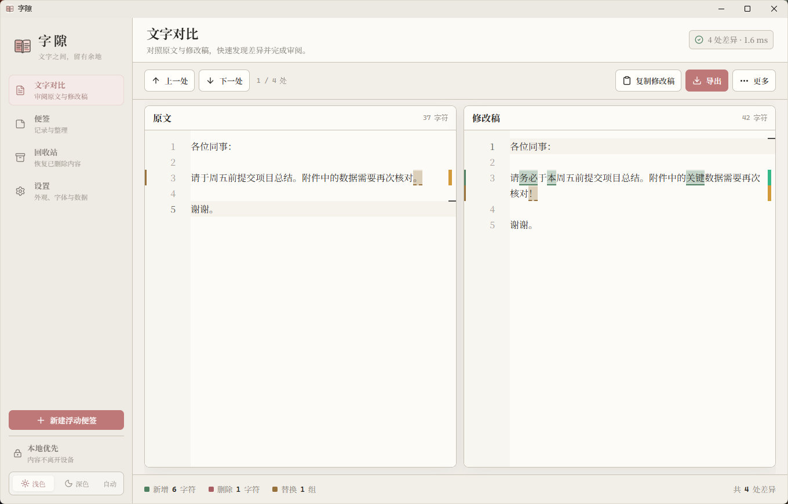
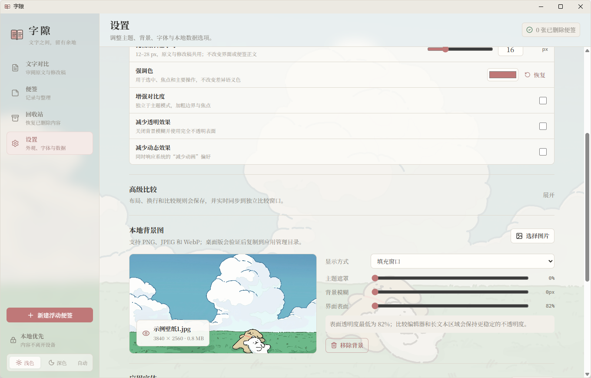

# 字隙

字隙是一个面向日常办公与阅读的本地优先桌面工具。它把原文与修改文并排展示，以确定性规则高亮新增、删除和替换内容；同时提供桌面便签、历史版本、回收站、样式定制、多格式导出和本地 TXT 阅读器。

技术栈为 Tauri 2、React、TypeScript、Vite、Monaco Editor、jsdiff 与 SQLite。可用版本以 GitHub Releases 为准。

## 界面预览





## 下载与安装

普通 Windows 用户无需安装 Node.js、Rust 或其他开发工具。请前往 [GitHub Releases](https://github.com/Iridium1024/zixi/releases/latest)，下载名称以 `Windows-x64-Setup.exe` 结尾的安装包并双击安装。

- `Zixi-<版本>-Windows-x64-Setup.exe`：推荐普通用户使用。
- `Zixi-<版本>-Windows-x64-Portable.zip`：免安装版，完整解压后双击根目录 `zixi.exe`。默认不创建桌面快捷方式；可选工具位于 `scripts/Create Desktop Shortcut.cmd`。
- `Zixi-<版本>-Windows-x64.msi`：供需要 MSI 的管理或批量部署环境使用。
- `Source code (zip)` / `Source code (tar.gz)`：仅供开发者获取源码，不是可直接运行的软件。
- `SHA256SUMS.txt`：用于核对安装包是否完整、是否与发布页提供的文件一致。

当前公开构建面向 Windows 10/11 x64，尚未进行商业代码签名，因此 Windows SmartScreen 可能显示“未知发布者”。请只从本仓库 Releases 页面下载。安装升级或卸载程序不会主动删除 `%APPDATA%\com.zixi.desktop` 中的用户数据库与外观资源。

免安装版需要系统已安装 WebView2 Runtime；缺少时请使用安装版。默认使用 AppData 数据目录，可在设置中迁移资料位置。请保留随包的 `fonts` 文件夹。GitHub 自动生成的源码 ZIP 不包含 EXE，请选择名称含 `Portable` 的发布附件。

## 主要能力

- 双栏文字比较：精确、审阅、宽松三种规则；上一处/下一处、统计、交换与同步滚动。
- Unicode 友好：覆盖中文、英文、数字、标点、换行、空白、组合字符与 emoji；长文本在 Web Worker 中计算并有可见的降级策略。
- 桌面便签：新建、搜索、编辑、独立窗口、置顶、回收站；回收站支持明确的多选、筛选内全选、批量恢复、批量永久删除，以及每张最多 10 个、至少间隔 5 分钟的稀疏内容版本。
- TXT 阅读：导入本地 TXT，在独立窗口中按章节局部滚动或分页阅读；书架支持排序、显示阅读进度和管理书籍。
- 思维导图：新建并保存简单的横向树状图，编辑、增删与拖动节点，使用撤销、重做和画布缩放整理内容。
- 外观：浅色、深色、跟随系统三种主题；主窗口和阅读窗口使用可操作的自定义标题栏；增强对比、减少透明和减少动画作为独立无障碍偏好。
- 本地背景与字体：背景图可预览、调整遮罩/模糊/表面透明度并保存管理副本；字体可按界面、比较器和默认便签三个范围导入应用。
- 便签样式：每张便签可单独设置字体、字号、行距、文字色、背景色和透明度；单张覆盖优先于全局默认。
- 本地持久化：SQLite + WAL；比较会话、设置、便签和版本记录保存在本机。独立便签可选择关闭时询问、自动保存或不保存。
- 导出：TXT、Markdown、JSON、带高亮的 HTML 和 Unified Diff；保存路径由用户明确选择。
- 比较正文：原文与修改稿共用 12–28px 的持久化字号和联动行高；界面字号、比较正文字号与便签正文字号彼此独立。
- 桌面生命周期：单实例、主窗状态恢复、关闭到系统托盘、托盘新建便签与退出。

### 导航与便签文件夹

标题栏左侧按钮用于在展开导航和图标窄栏之间切换。展开时，上方为六个功能入口，下方为当前功能的可滚动目录（便签、书目、导图或设置章节）；收起时仍可通过图标切换功能，悬停或键盘聚焦可查看名称。窄窗口下展开目录会覆盖部分正文，收起即可继续编辑。

浅色、深色与自动主题使用等宽按钮，选中背景在三个选项间平滑滑动；窄栏底部的主题按钮可打开主题浮层，点击外部或按 Esc 关闭。导航、主题浮层、文件夹和右侧设置栏的动画遵循系统及应用中的“减少动画”偏好。主标题栏采用 34px 高度，日常状态以轻量文字呈现，错误状态仍突出显示。

便签、思维导图和回收站共用单行目录标题栏：标题靠左，功能图标靠右，操作说明显示在 tooltip。便签目录提供搜索、新建文件夹、新建便签与删除入口。搜索以轻量弹窗呈现，按 Esc 或点击遮罩关闭；选择搜索结果前会先保存当前草稿。回收站的搜索弹窗还可将搜索条件应用到列表，继续执行筛选内全选、批量恢复或删除。

文件夹保持单层结构，文件夹旁提供重命名和删除；文件夹内的便签缩进显示，列表只常驻标题，长标题可悬停查看。通过目录下拉框筛选文件夹；通过便签行的“更多”按钮或右键菜单移动便签。在特定文件夹筛选下新建便签会归入该文件夹，其余入口的新便签默认未分类。删除文件夹只移除归属，包含回收站中的便签也会回到未分类，正文、历史版本和删除状态均保留。文件夹信息独立持久化，不会因浮窗正文保存而被覆盖。

便签标题与操作图标收纳在便签内部，标题前的文件夹图标可悬停或聚焦查看归属；最右侧按钮用于平滑展开、收起便签设置，右侧面板仍可调整外观、导出和恢复历史版本。便签使用固定的内外阴影，正文聚焦时不添加外框；控件默认透明，以逐渐加深的中性蒙版区分悬停、聚焦和按下。正文独立裁切在标题下方，上下边缘使用透明度遮罩渐隐，顶部约 1rem、底部约 22px，文字本身不做模糊；到达首行或末行时关闭对应遮罩，保留完整阅读区域。主导航底部的常驻“新建浮动便签”按钮已移除，仍可通过托盘新建浮动便签，或从便签内的独立窗口图标打开。

内容遮罩仅作用于正文或固定画布视口，标题、滚动条和菜单保持清晰；顶部过渡层独立采用约 200ms 的透明度动画。思维导图的遮罩不跟随平移和缩放，“减少透明效果”会关闭这些透明度效果；主导航悬停与键盘聚焦分别提供不同深度的反馈，便签列表整行使用连续的背景蒙版。状态信息显示在各视图内部，主窗口标题栏不再重复显示状态。悬停或聚焦说明统一使用黑底白字的圆角浮层，完整可读的导航和名称不重复提示；纯图标操作及确实截断的标题保留说明，浮层自动避开窗口边缘。其它视图的装饰分隔线在两端留空，控件圆角适度增加，便签本体圆角保持原样。

应用原生滚动条改为约 8px 的透明轨道，滑块默认较淡，悬停或拖动时加深；两端的步进按钮已移除。比较编辑器采用对应的细滚动条配置，滚轮、滑块拖动和键盘滚动保持可用。

## 从源码开发

要求：

- Node.js 20.19+ 或 22.12+
- npm 10+
- Rust stable（构建桌面版时）
- Windows 上构建 Tauri 需要 WebView2 与 MSVC C++ 构建工具；也可以使用 LLVM + cargo-xwin。

安装依赖并启动浏览器开发界面：

```powershell
npm ci
npm run dev
```

启动 Tauri 桌面开发版：

```powershell
npm run tauri dev
```

## 验证与构建

完整前端质量门：

```powershell
npm run check
```

该命令依次执行 TypeScript 类型检查、ESLint、Vitest 和 Vite 生产构建。桌面安装包构建：

```powershell
npm run tauri build
```

要同时生成安装包、免安装 ZIP，并刷新项目根目录可双击的启动入口，运行：

```powershell
npm run release:build
```

完成后，项目根目录直接提供 `zixi.exe` 和 `fonts/`，仅保留一份简短 README。可选快捷方式工具放在 `scripts/`，不会自动在桌面创建入口。根目录 EXE 是正式 `src-tauri/target/release/zixi.exe` 的分发副本，两者由同一构建生成；独立比较窗口仍属于同一程序。更新前须从系统托盘退出字隙，避免旧 EXE 锁定。目录用途见 [项目目录说明](PROJECT-STRUCTURE.md)。

若已有最新正式构建，可用 `npm run release:local` 仅刷新根目录入口，或 `npm run release:stage` 同步整理三个发布包及 SHA-256 校验文件。分发产物位于 `releases/v<版本>/`，不提交 EXE 或 Rust 缓存到源码仓库。`npm run release:check` 审核上传候选文件和版本；`npm run release:verify` 检查 ZIP 根目录、字体资源、隔离目录快捷方式与校验和。CI 只上传明确列出的四个发布附件，且拒绝覆盖已经公开的 Release。

开发期原生可执行文件会生成在 `src-tauri/target/<target>/<profile>/zixi.exe`。Windows 标准发布环境优先使用 MSVC Build Tools；本项目也已在 LLVM `clang-cl` + `lld-link` + cargo-xwin sysroot 的替代工具链上完成原生编译。

若 Windows 机器未安装 MSVC C++ workload，可在准备好 LLVM 与 cargo-xwin 后执行 Rust 检查：

```powershell
cargo xwin check --cross-compiler clang --target x86_64-pc-windows-msvc --manifest-path src-tauri/Cargo.toml
```

## 数据位置与备份

SQLite 文件名为 `zixi.db`，位于 Tauri 的应用配置目录。Windows 默认位置为：

```text
%APPDATA%\com.zixi.desktop\zixi.db
```

启用 WAL 后同目录还可能出现 `zixi.db-wal` 与 `zixi.db-shm`。应用的“设置 → 数据与备份 → 定位资料目录”可以在资源管理器中定位当前资料文件夹。

在“更改存储位置”中选择存放位置后，应用会在其中创建 `ZixiData` 文件夹。保存并关闭所有独立窗口，再确认“迁移并重启”；启动时会备份 SQLite（包含 WAL 中已提交的内容）、复制并校验书库、协作文件、导入字体和背景，同时更新资料内的资源路径。完成后才启用新目录；失败则继续使用原目录并在设置中显示原因。已有的 `ZixiData` 不会被覆盖，原资料目录保留为备份，不会自动删除。

更改资料目录后，少量启动定位配置 `storage-location.json` 和窗口布局仍保存在默认配置目录，WebView 用户数据与缓存仍位于系统目录。备份时以设置中显示的“当前资料目录”为准，同时保留默认配置目录中的定位配置；不要在应用运行时手工搬动数据库。自定义磁盘不可用时应用会停止启动，以免生成空资料库；请先恢复该磁盘，或在完全退出后检查默认配置目录中的定位配置。

未更改存储位置时，外观资源同样保存在该配置目录下；迁移后位于所选资料目录的对应子目录：

```text
%APPDATA%\com.zixi.desktop\appearance\backgrounds
%APPDATA%\com.zixi.desktop\appearance\fonts
```

桌面版会在用户明确选择文件后验证格式，再复制到这些应用管理目录。移动、重命名或删除原文件不会影响已经应用的资源；在应用内移除资源时，只删除字隙自己的副本，不会删除原文件或系统字体。

冷备份建议：先从系统托盘退出字隙，再复制整个当前资料目录（默认是 `com.zixi.desktop`）；恢复时也应在应用完全退出后恢复整个目录，避免遗漏 WAL 中尚未合并的数据。恢复到不同位置时应使用迁移功能更新书库和外观资源路径。

浏览器开发预览不具备 Tauri 原生 SQLite 能力，会使用浏览器 `localStorage` 作为可测试的降级存储；它与桌面版数据库不是同一份数据。

## 思维导图与协作文件

- 在主导航选择“思维导图”，新建导图后可选中节点，再用工具栏添加子节点、同级节点或编辑节点。双击节点可编辑，Tab 可添加子节点；长文本会换行。右键拖动画布，`Ctrl+滚轮`缩放，也可用“适应画布”查看整张图。
- 每个节点末尾的箭头可单独折叠或展开；折叠时该节点缩为单行并隐藏子节点，完整文字和下级各自的折叠状态仍会保存。`Ctrl+点击`箭头也只改变当前节点。
- 节点编辑完成后自动保存，`Ctrl+S` 可立即保存。单张导图可通过“独立窗口”打开；同一导图重复打开会聚焦已有窗口。窗口间发生编辑冲突时，可将本地草稿另存为新导图，或确认放弃草稿后重新载入。删除导图需明确确认，且不会进入便签回收站。
- 便签和导图的“复制路径”会生成当前已保存版本的单条文件副本，并仅将其绝对路径放入剪贴板。便签副本为 TXT，导图副本为 JSON，**文件包含完整内容**；后续在字隙中的更改不会自动更新旧副本。副本保存在应用数据目录的 `collaboration` 文件夹中，不会自动清理。
- Agent 可在有文件访问权限时读取或编辑导图 JSON。保留 `format`、`version`、`mapId`、`baseUpdatedAt` 和保留节点的 ID；添加节点需使用唯一的字母、数字、连字符或下划线组成的 ID。若删除节点，需把被删除节点及其子节点的 ID 明确列入 `removedNodeIds`。修改后在该导图页选择“应用外部修改”，程序会检查结构及生成时的版本，并保留现有节点的折叠状态；如原导图已变化，副本不会被自动覆盖或合并。便签文本副本不支持写回。
- 浏览器开发预览使用另一份数据，不能创建桌面协作文件或打开原生独立窗口。

## 隐私与安全

- 文字比较在本机 Web Worker 中完成，不调用 AI 或云端服务。
- 便签、比较会话、设置和版本记录默认只保存在本机。
- 导出仅在用户选择目标路径后写入；应用不会自动上传导出文件。
- 导入的背景图和字体仅在本机应用配置目录中使用，不上传、不安装到操作系统，也不会随公开构建产物分发。
- Tauri 使用最小能力清单：导出写入保存对话框授予的路径；外观导入只由主窗口调用 Rust 命令打开系统选择器并立即把所选文件复制到当前资料目录的受限外观子目录，前端不能向导入命令提交任意路径；外部打开能力用于在资源管理器中定位资料。

## 外观格式与回退

- 背景图稳定支持 PNG、JPEG/JPG、WebP，单文件上限 24 MB，最长边不超过 10000 像素且总像素不超过 4000 万。
- 应用字体支持 WOFF2、WOFF、TTF、OTF，单文件上限 12 MB；TTC、Type 1、字体集合及特殊可变字体不承诺兼容。
- 应用随包提供 OFL 1.1 许可的 Noto Serif SC（思源宋体）可变字体，界面、比较编辑器和跟随默认设置的便签无需依赖系统字体即可使用；字体文件与许可证位于 Tauri 的 `fonts` 资源目录。
- 文件扩展名必须与实际文件头一致。损坏、伪造或浏览器/WebView 无法解析的文件会被拒绝并显示原因。
- 背景资源丢失时回退主题默认背景；字体加载失败、缺少字形或被删除时回退系统中文字体栈，应用仍可启动。
- “跟随系统”会在运行期间监听系统浅深色偏好；增强对比度不占用主题选项。

## 已知限制

- 第一阶段不提供云同步、账号、多用户协作或 AI 语义等价判断。
- 不解析 Word 富文本，也不提供 PDF/DOCX 高保真导出。
- Unified Diff 使用 jsdiff 生成标准上下文 hunk；无业务差异时只输出文件头。它针对纯文本，不保留 Word 等富文本样式。
- 超过约 10 万字符的比较会优先转为行级策略；极端差异会退化为全文替换，以保证输入界面仍可响应。
- 便签列表尚未虚拟化；MVP 适合日常数量的便签，不以数万条记录为目标。
- 字体显示名首版使用受控文件名，不解析或修改字体许可证、内部家族冲突及高级可变轴；同一文件内容使用 SHA-256 标识避免重复复制。
- 浏览器开发预览会以 Data URL 临时模拟本地外观资源；桌面版的应用管理副本与 SQLite 设置才是正式行为。
- 跨全屏应用强制置顶、鼠标穿透和桌面壁纸层不在当前范围。

## 许可证

本项目使用 [MIT License](../LICENSE)。第三方直接依赖、版本与许可证见 [THIRD_PARTY_NOTICES.md](THIRD_PARTY_NOTICES.md)。项目仅借鉴公开项目的架构和交互思路，没有复制许可证不明确项目的代码、品牌或资源。

### 目录多选、移动与排序

- 便签、回收站、思维导图和书架目录支持 Ctrl+点击增减选择；便签和导图多选时保留当前编辑内容。
- 可拖动一张或所选多张便签到文件夹标题上改变归属，也可继续使用“更多”菜单。文件夹保持单层，拖动文件夹只改变顺序。
- 拖到对象上半部插入其前，下半部插入其后。手动顺序独立保存，不受正文编辑时间影响；书架拖动后自动切换到“手动排序”，仍可切回其它排序方式。
- 便签删除和回收站永久删除入口位于目录顶部，操作前在按钮附近确认；回收站通过全选和同一删除按钮批量清理，不再另设“清空”。文件夹删除保留便签并移回未分类。
- 设置、便签和阅读器等页面的复选框、开关、下拉选择与范围滑块共享统一样式；下拉面板支持键盘操作。

### 比较工作区的操作与报告

比较工作区顶部左侧显示紧凑统计和状态，新增、删除和替换前分别使用绿、红、棕黄色标；右侧依次提供差异导航及计数、交换、清空、独立窗口和报告导出。原文和修改稿各自的标题栏提供复制、TXT 导出和转为便签；全局报告导出保留 Markdown、JSON、HTML 和 Unified Diff 格式。底部不再重复设置统计栏。

报告必须等待当前文本与规则的比较完成后导出，JSON 会保留完整自定义规则。Unified Diff 明确表示原始文本补丁，不应用审阅模式的忽略规则。长文本允许降低显示粒度，但不会因文本长度改变空白规范化的含义。
